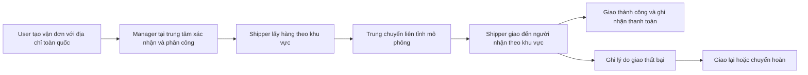

# UTEExpress — phạm vi đã chốt và đối chiếu yêu cầu

Ngày rà soát: 12/10/2026. Căn cứ: nội dung đề a–e do thành viên nhóm cung cấp; file `D:/WEB/KhaoSat_PhanTichHeThong.docx`; mã nguồn local `feature_Tho` tại commit `1ada00d` và các thay đổi chưa commit; bản `origin/develop` đã fetch tại commit `99e5f35`; nguồn chính thức của GHN, GHTK và Viettel Post.

Theo xác nhận của thành viên nhóm ngày 12/10/2026, giảng viên đã đồng ý áp dụng mục (c) cho mô hình logistics và vai trò bổ sung Shipper. Nhóm chọn phạm vi **nhận và giao toàn quốc, mô phỏng mạng giao nhận dưới một trung tâm điều phối**. Việc xác nhận mô hình/vai trò chưa thay thế việc đối chiếu bộ chức năng chi tiết và minh chứng kiểm thử.

## 1. Kiểm tra cloud database

- Công cụ `CheckAivenConnection` đã kết nối Aiven MySQL 8.4 thành công bằng cấu hình local hiện có.
- `SELECT 1` thành công; kết nối dùng TLS và `VERIFY_IDENTITY` để xác minh danh tính máy chủ.
- Database có 17 bảng; đủ 10 bảng mà công cụ của phiên bản local yêu cầu. Con số này không phải danh sách bảng bắt buộc cho phiên bản cuối cùng.
- `ca.pem` ở gốc project và `config/certificates/ca.pem` có cùng SHA-256.
- Trang chủ ứng dụng đang chạy trả HTTP 200; controller đọc thống kê và đánh giá từ database.
- Kiểm tra này xác nhận kết nối/schema của phiên bản đang chạy. SMTP gửi OTP thực tế, callback thanh toán và toàn bộ nghiệp vụ cần bằng chứng kiểm thử riêng.

## 2. Cách hiểu đúng tài liệu đề

File Word cung cấp mẫu Chương 2 khảo sát Tiki, Shopee, Lazada, Etsy và Chương 3 phân tích/thiết kế sàn bán hàng. Bảng 3-1 đến 3-4 mô tả Guest/Customer/Vendor/Admin; mẫu không có Manager/Shipper. Các bảng shop, product, cart, commission và kiểu ObjectId thuộc mô hình ví dụ.

Phần cần học theo mẫu là cấu trúc hồ sơ: khảo sát có ảnh và ưu/nhược điểm; bảng chức năng theo tác nhân; Use case Diagram; đặc tả use case có luồng chính/thay thế/ngoại lệ; Sequence Diagram; ERD; mô tả bảng, kiểu dữ liệu và ràng buộc. Với UTEExpress, dùng khảo sát hãng chuyển phát và thiết kế MySQL thực tế của nhóm.

Mục (c) của đề được cung cấp xác định Guest, User, Manager, Admin cho đề tài không bán hàng và yêu cầu thảo luận chức năng từng role với giáo viên. Mô hình UTEExpress và phần bổ sung Shipper đã được giảng viên đồng ý theo xác nhận của thành viên nhóm. Các yêu cầu riêng của sàn bán hàng cần được ghi rõ về việc bỏ hoặc quy đổi sang nghiệp vụ logistics trong bộ chức năng chi tiết.

## 3. Số vai trò thống nhất

**Trong báo cáo/use case: 5 tác nhân — Guest, User, Shipper, Manager, Admin.**

**Trong tài khoản và enum `AppUser.Role`: 4 giá trị — USER, SHIPPER, MANAGER, ADMIN.** Guest là người chưa đăng nhập, không có tài khoản hay giá trị role riêng. Shipper là vai trò bổ sung phục vụ nghiệp vụ giao nhận đã được giảng viên đồng ý theo xác nhận của thành viên nhóm.

| Tác nhân | Trách nhiệm trong phạm vi hệ thống |
| --- | --- |
| Guest | Xem dịch vụ/phạm vi phục vụ, ước tính cước, tra cứu trạng thái công khai, đăng ký và kích hoạt OTP. |
| User | Người gửi hàng là cá nhân hoặc chủ shop; quản lý hồ sơ/địa chỉ, đơn nháp, tạo đơn, thanh toán cước, theo dõi/hủy theo quy định, đánh giá và khiếu nại. |
| Shipper | Chỉ xử lý đơn được phân công; lấy/giao hàng, ghi kết quả và lý do thất bại, bằng chứng giao hàng, thu/nộp tiền theo phạm vi đã chốt, thống kê cá nhân. |
| Manager | Điều phối mạng giao nhận toàn quốc mô phỏng từ trung tâm; phân công Shipper theo khu vực/công việc, giám sát đơn, xử lý giao lại/chuyển hoàn/khiếu nại, đối soát và báo cáo vận hành. |
| Admin | Quản lý tài khoản và phân quyền; cấu hình dịch vụ, vùng phục vụ, bảng cước, khuyến mãi; giám sát hệ thống và sử dụng các chức năng Manager. |

Không thêm Vendor/Seller trong phạm vi hệ thống. Chủ shop sử dụng UTEExpress để gửi bưu kiện vẫn là USER, không mở gian hàng hoặc đăng bán sản phẩm trên hệ thống. Người nhận được lưu trên vận đơn và có thể tra cứu công khai; không cần thêm role người nhận.

## 4. Phạm vi một thương hiệu, một trung tâm điều phối

Tên đề tài: **Hệ thống quản lý dịch vụ chuyển phát bưu kiện nội địa UTEExpress**.

**Phạm vi đã chọn:** một thương hiệu UTEExpress, nhận và giao bưu kiện tại các địa bàn phục vụ trên toàn quốc, quản lý tập trung dưới một trung tâm điều phối. Shipper được phân công theo khu vực/công việc; lấy hàng, trung chuyển liên tỉnh và giao cuối chặng được mô phỏng bằng sự kiện vận đơn. Trung tâm là đơn vị quản lý nghiệp vụ trong phần mềm; mạng giao nhận các địa phương được trừu tượng hóa, không buộc mọi kiện hàng đi qua một kho vật lý duy nhất.

Luồng nghiệp vụ trong phạm vi đã chọn:

Các giới hạn định lượng:

- Một thương hiệu, một trung tâm điều phối được quản lý trong phần mềm, một website, một database dùng chung; địa chỉ lấy và giao hàng thuộc các địa bàn phục vụ trên toàn quốc.
- Bốn role tài khoản, không có quản lý Seller/shop hoặc nhiều hãng vận chuyển.
- Có thể giữ ba loại dịch vụ hiện tại; mỗi dịch vụ có vùng áp dụng và thời gian dự kiến. Hỏa tốc chỉ được chọn trong vùng hỗ trợ đã cấu hình.
- Địa chỉ và vùng phục vụ lấy từ dữ liệu có phiên bản/cấu hình; không dùng số tỉnh từ bài khảo sát cũ làm danh mục địa chỉ hiện hành.
- Không cam kết thời gian giao dựa trên GPS/tuyến xe thực; không triển khai chuyển phát quốc tế, hệ thống nhiều kho/chi nhánh, nhượng quyền, tối ưu tuyến bằng AI hoặc ứng dụng di động riêng trong phiên bản cuối kỳ.

## 5. Bài học từ các mô hình express

| Nguồn chính thức | Bài học dùng cho phạm vi đồ án |
| --- | --- |
| [GHTK — E-Logistic](https://api.ghtk.vn/docs/intro/) | Hoàn thiện tạo đơn, tra cứu, tính phí, in nhãn và hủy; cập nhật trạng thái bằng sự kiện. WebSocket hiện có của nhóm phù hợp với hướng này. |
| [GHN — Bảng giá/chính sách dịch vụ](https://ghn.vn/pages/bang-gia-moi-sieu-tiet-kiem) | Thiết kế cước theo tuyến/vùng và khối lượng tính cước; tách cước, tiền hàng thu hộ và tiền hoàn trả người gửi. GHN có chính sách khối lượng quy đổi dài × rộng × cao / 5.000; hệ số của UTEExpress cần là quy tắc riêng, có thể cấu hình. |
| [GHTK — Giao lại](https://ghtk.vn/blog/giao-lai/) | Lưu lý do và từng lần giao thất bại, xử lý giao lại hoặc chuyển hoàn; không kết thúc đơn ngay sau lần giao không thành công đầu tiên. Số lần thử lại là chính sách riêng của nhóm. |
| [Viettel Post — Giới thiệu mạng lưới](https://en.viettelpost.com.vn/gioi-thieu-2) | Nghiệp vụ toàn quốc có các điểm giao nhận/trung tâm khai thác. Trang giới thiệu này là tài liệu lịch sử, chỉ dùng tham khảo cấu trúc, không lấy số bưu cục hoặc địa bàn làm số liệu hiện hành. |
| [GHN — Mã trạng thái vận đơn](https://developer.ghn.vn/vi/docs/master-data/order-status) | Tách rõ lấy hàng, vận chuyển, giao cuối chặng, giao thất bại, chuyển hoàn và hủy. Chọn một bộ trạng thái gọn cho đồ án và đặc tả quyền chuyển trạng thái. |

Phạm vi một trung tâm điều phối và mạng giao nhận toàn quốc mô phỏng là quyết định thiết kế đã chọn cho đồ án, không phải mô hình vận hành được các hãng công bố.

## 6. Đối chiếu yêu cầu và hiện trạng

| Yêu cầu đề | Cách đáp ứng trong UTEExpress | Hiện trạng đã xác minh |
| --- | --- | --- |
| Khảo sát, phân tích, thiết kế | Khảo sát hãng express; chức năng theo 5 tác nhân, use case, sequence, ERD, từ điển dữ liệu | Cần hoàn thiện hồ sơ cho mô hình logistics; mẫu Word bán hàng chưa là hồ sơ của nhóm. |
| Phân công và commit | Thọ: Guest/User; Tài: Shipper; Thắng: Manager/Admin; tích hợp và test quyền dùng chung | Có nhánh/lịch sử Git; cần báo cáo và bằng chứng phần việc từng thành viên. |
| Mô hình 3 tầng | Controller → Service → Repository, entity/DTO riêng | Có trong mã nguồn. |
| Một template Bootstrap, responsive | Khung Thymeleaf chung + Bootstrap, các màn hình dùng cùng layout | Có khung chung; cần checklist ảnh/test trên desktop và điện thoại. |
| OTP, mật khẩu mã hóa, Spring Security | Đăng ký/quên mật khẩu qua email, BCrypt, phân quyền session và CSRF | Có mã nguồn; kết nối database được xác minh, gửi OTP thật chưa được kiểm thử ở lượt rà soát này. |
| Tìm kiếm/lọc/phân trang | Tìm kiếm và lọc vận đơn theo mã, trạng thái, ngày; dịch vụ/vùng phục vụ | Có tra cứu/lọc đơn; cước/vùng phục vụ chưa cấu hình đầy đủ. Việc quy đổi cần giáo viên xác nhận. |
| Giỏ hàng database | Danh sách vận đơn nháp lưu database | Đã có; nên gọi là đơn nháp/đơn chờ xác nhận, không trình bày như giỏ sản phẩm của sàn. |
| Thanh toán và lịch sử | Thanh toán cước, lịch sử vận đơn, trạng thái nghiệp vụ | Có thu cước khi nhận hàng; VNPay/MoMo mô phỏng, chưa là tích hợp sandbox thật. |
| Đánh giá/bình luận đã sử dụng dịch vụ | Chỉ người gửi của đơn giao thành công đánh giá; text tối thiểu 50 ký tự và tệp phù hợp | Code kiểm tra chủ đơn/DELIVERED; DTO local có sửa min 50 + trim, phần sửa này chưa nằm trong commit demo `1ada00d`. |
| Vai trò Guest/User/Manager/Admin ở đề tài khác | Dùng bốn actor nền tảng, thêm Shipper nghiệp vụ | Giảng viên đã đồng ý mô hình logistics và Shipper theo xác nhận của thành viên nhóm; cần hoàn thiện bộ chức năng chi tiết và minh chứng. |
| Chức năng sáng tạo tương đương | WebSocket thông báo trạng thái, có thể bổ sung QR/in nhãn | WebSocket có triển khai. JWT filter vẫn là TODO; không báo cáo JWT đã hoàn thành. |
| Vendor/sản phẩm/top 10–20/yêu thích/shop/chiết khấu sàn | Không tự áp nguyên xi cho dịch vụ express | Cần ghi rõ phần bỏ/quy đổi và xin xác nhận theo mục (c); không tạo sản phẩm giả hoặc thêm Vendor chỉ để khớp mẫu. |

Không có đủ bằng chứng để khẳng định đồ án đã đáp ứng toàn bộ các tiêu chí chấm điểm. Ưu tiên hoàn thiện logic/validation/security của từng role vì nhóm tiêu chí này chiếm 6/10 điểm.

## 7. Những chỉnh sửa cần ưu tiên

1. **Thống nhất phiên bản tích hợp.** Local `feature_Tho` hiện khác `origin/develop`. Mã Java trên `origin/develop` đã có phân công, lịch sử trạng thái, giao lại/lý do thất bại, khiếu nại, QR và đối soát thu cước; nhiều phần chưa có trong phiên bản local đang chạy. Kiểm tra và tích hợp các phần sẵn có trước khi viết mới, đồng thời giữ các thay đổi local chưa commit.
2. **Làm cước và vùng phục vụ nhất quán.** `OrderServiceImpl` vẫn dùng giá gán trong code ở cả hai phiên bản đã kiểm tra. Bổ sung bảng cước tối thiểu theo dịch vụ/tuyến/vùng/trọng lượng; kiểm tra vùng hỗ trợ; chốt cước tại thời điểm tạo đơn để sửa bảng giá không đổi tiền của đơn cũ.
3. **Phân biệt COD hàng hóa với thu cước.** `OrderPaymentServiceImpl` hiện tính amount từ cước trừ giảm giá. Phạm vi tối thiểu có thể gọi đúng là thanh toán cước khi nhận hàng. Nếu nhóm chọn COD hàng hóa cho chủ shop, cần thêm giá trị thu hộ, thu/nộp/hoàn tiền người gửi và đối soát riêng; chọn luồng này để hoàn thiện sau các chức năng lõi.
4. **Hoàn thiện quyền quản trị.** Admin hiện chủ yếu quản lý hồ sơ nhân sự Admin/Manager; cần quản lý khách hàng/Shipper và cấu hình dịch vụ/cước/khuyến mãi phù hợp bộ chức năng đã thống nhất. Manager tập trung điều phối và xử lý vận hành; Admin tập trung tài khoản và cấu hình.
5. **Chốt quy tắc trạng thái và kiểm thử ngoại lệ.** Lưu sự kiện gồm người thao tác/thời gian/trạng thái/lý do; giới hạn quyền hủy/phân công/đổi trạng thái; kiểm tra chủ đơn; đảm bảo giao thất bại có đường giao lại/chuyển hoàn. Kiểm tra giao dịch tạo đơn/thanh toán/khuyến mãi và thao tác đồng thời.
6. **Làm báo cáo khớp code và minh chứng.** Một số nội dung trong `origin/develop:SETUP.md` và `docs/thang/OPERATIONS_UPGRADE.md` mô tả quản lý toàn bộ tài khoản, `ShippingTariffService` và audit mà chưa thấy mã Java tương ứng trong tree đã kiểm tra. Chỉ đánh dấu hoàn thành khi có code, giao diện và kết quả test. Validation độ dài tên/địa chỉ, điện thoại, trọng lượng và tệp cũng cần checklist cụ thể.

## 8. Các quyết định đã xác nhận và nội dung còn cần thống nhất

- Giảng viên đã đồng ý mô hình logistics theo mục (c) và phần bổ sung Shipper, theo xác nhận của thành viên nhóm ngày 12/10/2026.
- Nhóm chốt 5 tác nhân và 4 role tài khoản; không có Vendor/Seller.
- Nhóm chọn nhận và giao toàn quốc, mô phỏng mạng giao nhận dưới một trung tâm điều phối.
- Các chức năng bán hàng được bỏ hoặc quy đổi: sản phẩm/shop → dịch vụ/vận đơn; giỏ hàng → đơn nháp; đánh giá sản phẩm → đánh giá sau giao thành công; khuyến mãi → giảm cước. Các phép quy đổi là đề xuất, chưa là xác nhận của giáo viên.
- Ghi cụ thể mức mô phỏng lấy/giao theo khu vực và trung chuyển liên tỉnh trong báo cáo, use case và kịch bản demo.
- Thanh toán cước khi nhận hàng có đủ cho phạm vi đã chốt hay cần thêm một cổng sandbox; ưu tiên chọn một cổng nếu được yêu cầu.

Dùng cùng bộ role/phạm vi đã chốt cho README, báo cáo khảo sát, use case, ERD, phân công nhóm, test case và kịch bản demo. Các chức năng chi tiết còn cần thống nhất không làm thay đổi xác nhận đã có về mô hình logistics và Shipper.
